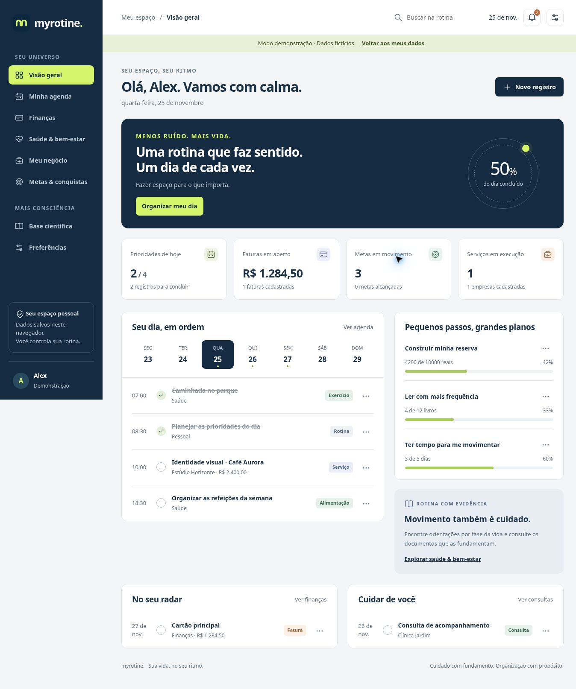

<div align="center">
  
  <h1>myrotine.</h1>
  <p><strong>Sua vida, no seu ritmo.</strong></p>
  <p>Rotina, saúde, dinheiro e trabalho.<br>Um espaço para conectar tudo o que faz parte de você.</p>
  <p>
    <a href="https://github.com/brunnojob/myrotine/actions/workflows/ci.yml"></a>
    <a href="LICENSE"></a>
    
    
  </p>
  <p><a href="#começar">Começar</a> · <a href="#o-que-já-funciona">Funcionalidades</a> · <a href="#ciência-sem-caixa-preta">Ciência</a> · <a href="#privacidade-e-limites">Privacidade</a> · <a href="docs/ROADMAP.md">Roadmap</a></p>
</div>



## Por que existe

A fatura fica no banco. A consulta, numa conversa. O treino, numa nota. O prazo do cliente, na cabeça. A fragmentação transforma cuidar da vida em mais uma tarefa.

**MyRotine reúne esses compromissos numa visão coerente do dia**, com metas mensuráveis, uma agenda de cuidados e gestão de serviços para quem também toca um negócio. Sem pontuação de saúde inventada, sem promessa de produtividade infinita, sem exigir assinatura para organizar sua rotina.

Esta é uma **primeira versão funcional local-first**. Os cadastros, indicadores e exportações funcionam no navegador. Contas, sincronização e envio de lembretes por servidor ainda não estão implementados.

## Começar

Requer **Node.js 22+**. Não precisa instalar pacotes nem configurar chaves.

```bash
git clone https://github.com/brunnojob/myrotine.git
cd myrotine
npm run dev
```

Abra **http://localhost:3000**. Escolha **Criar minha rotina** para começar do zero ou **Explorar demonstração** para conhecer os módulos com dados fictícios. O modo demonstração não altera seus registros pessoais.

<details>
<summary><strong>Quero testar em dois minutos</strong></summary>

1. Entre em **Explorar demonstração**.
2. Em **Visão geral**, conclua uma atividade e veja os indicadores mudarem.
3. Em **Finanças**, cadastre uma fatura com vencimento e recorrência.
4. Em **Meu negócio**, mude a etapa de um serviço.
5. Em **Metas & conquistas**, atualize o progresso de uma meta.
6. Em **Saúde & bem-estar**, alterne a faixa etária e abra uma fonte original.
7. Em **Preferências**, exporte um backup ou o calendário.

</details>

<details>
<summary><strong>Como gerar e hospedar o aplicativo</strong></summary>

```bash
npm run check
npm test
npm run build
```

Publique o conteúdo de `dist/` em uma hospedagem estática com HTTPS. Os caminhos são relativos, compatíveis com subdiretórios como `/myrotine/`.

O workflow **Publish Pages** está preparado para execução manual. Para usá-lo, configure **Settings → Pages → Source: GitHub Actions**, depois execute o workflow em **Actions**. Ele não habilita Pages sozinho. A publicação não vem com backend nem sincronização.

Para instalar como app, use o menu de instalação do navegador, quando disponível. O manifesto e o service worker permitem uso offline após a primeira visita bem-sucedida (o assistente exige internet). A instalação e as notificações dependem do navegador e do sistema operacional.

</details>

## O que já funciona

| Módulo | Entrega |
|---|---|
| **Visão geral** | Indicadores calculados a partir dos registros, semana navegável, próximas faturas e consultas |
| **Agenda** | Cadastro, edição, conclusão, exclusão, busca e filtros de rotina, consultas, exercícios e refeições |
| **Finanças** | Faturas em centavos, vencimentos, atraso, pagamento e recorrência mensal |
| **Saúde** | Conteúdo educativo por faixa etária, planejamento manual de atividades/refeições e fontes originais |
| **Negócio** | Empresas com validação de CNPJ numérico/alfanumérico, clientes, valores, prazos e serviços por etapa |
| **Metas** | Categoria, prazo, unidade, objetivo e progresso editável |
| **Lembretes** | Central de pendências, notificações com app aberto e exportação ICS com alertas |
| **Dados** | Persistência local, backup JSON, restauração validada, exclusão e demonstração isolada |

<details>
<summary><strong>Como os lembretes realmente funcionam?</strong></summary>

A agenda mostra pendências sem pedir permissão. As notificações do navegador precisam de autorização e do aplicativo aberto; o sistema operacional pode limitar a entrega.

Para lembretes com o app fechado, exporte o calendário ICS e importe-o no Google Calendar, Apple Calendar, Outlook ou outro calendário compatível. Confira o horário, o fuso e os alertas após importar. Uma nova exportação **não sincroniza** os eventos antigos e pode gerar duplicatas.

Ao concluir um registro recorrente, o MyRotine cria a próxima ocorrência. Vencimentos nos dias 29–31 se ajustam ao fim do mês preservando o dia original. A exportação usa regras de calendário para o mesmo ajuste; o suporte depende do cliente de calendário.

</details>

<details>
<summary><strong>O app cria dietas e treinos personalizados?</strong></summary>

Não. A versão atual organiza atividades, refeições e planos orientados por profissionais, e apresenta educação em saúde com referências. Ela não faz diagnóstico, avaliação clínica, prescrição de treino, déficit calórico ou dieta restritiva.

Crianças e adolescentes precisam da participação de responsáveis. Na primeira infância, as orientações encaminham aos documentos apropriados à idade. Gestação, doenças, deficiência e limitações exigem adaptações individuais com profissionais.

</details>

## Ciência sem caixa-preta

A área **Base científica** mostra instituição, edição, população e link de cada documento. Os filtros cobrem **0–1, 2–4, 5–17, 18–64 e 65+ anos**.

- [OMS — atividade física e comportamento sedentário, 2020](https://www.who.int/publications/i/item/9789240015128)
- [OMS — movimento, sedentarismo e sono em menores de 5 anos, 2019](https://www.who.int/publications/i/item/9789241550536)
- [Ministério da Saúde — Guia alimentar para a população brasileira](https://bvsms.saude.gov.br/bvs/publicacoes/guia_alimentar_populacao_brasileira_2ed.pdf)
- [Ministério da Saúde — Guia alimentar para menores de 2 anos](https://bvsms.saude.gov.br/bvs/publicacoes/guia_alimentar_criancas_brasileiras_menores_2_anos.pdf)
- [Documento de evidências do guia infantil, 2024](https://bvsms.saude.gov.br/bvs/publicacoes/diretrizes_recomendacoes_guia_alimentar_criancas.pdf)

**Referências não significam validação clínica do aplicativo ou endosso das instituições.** Consulte a [política de evidências](docs/SCIENCE.md).

## Uma identidade própria

Azul profundo, verde cítrico, tipografia de sistema e um monograma que representa continuidade. Interface em português, sem fontes remotas, sem bibliotecas visuais e sem gradientes decorativos. Logo, favicon e ícones de instalação estão em [`web/assets`](web/assets).

A marca foi criada para este projeto com geração de imagem; os tamanhos de favicon e instalação foram derivados do mesmo símbolo. A disponibilidade jurídica da marca não foi pesquisada.

## Privacidade e limites

- Os dados ficam **neste navegador**. Não há conta, telemetria ou sincronização entre dispositivos. O assistente opcional usa um servidor local e envia à Coarena somente as mensagens digitadas.
- O armazenamento e o backup não têm criptografia própria. Não use como cofre ou prontuário.
- Não cadastre senhas, número completo de cartão ou CVV.
- Limpar o navegador pode apagar os registros. Faça backups.
- Validar CNPJ não comprova existência ou situação cadastral.
- A versão 0.1 não é um SaaS multiusuário pronto para receber dados de terceiros.

Veja [segurança](SECURITY.md), [arquitetura e decisões](docs/ARCHITECTURE.md) e [o que vem depois](docs/ROADMAP.md).

## Qualidade e contribuição

```bash
npm run check  # verificação de sintaxe
npm test      # regras de negócio e casos de borda
npm run build # saída estática em dist/
```

Os testes cobrem calendário, meses curtos, ano bissexto, dinheiro em centavos, recorrência sem duplicação, CNPJ numérico/alfanumérico, validação de backups e progresso de metas. O workflow de qualidade executa os mesmos comandos e disponibiliza o build como artefato.

[Como contribuir](CONTRIBUTING.md) · [Reportar problemas](https://github.com/brunnojob/myrotine/issues) · [Licença MIT](LICENSE)

---

<div align="center"><strong>Organizar não é preencher cada minuto.<br>É abrir espaço para o que importa.</strong><br><br>Um projeto de <a href="https://github.com/brunnojob">Brunno</a>.</div>

## Assistente opcional com Coarena

O assistente ajuda a organizar prioridades e metas usando `gpt-6-luna`. Cada envio é uma pergunta independente; ele não lê seus registros nem cria compromissos. Somente o texto digitado é enviado à Coarena. Conversas ficam na memória da página, sem inclusão no backup. As respostas podem ser avaliadas como **Útil** ou **Não ajudou**; clicar novamente remove a avaliação.

Para usar no seu computador, com Node.js 22 ou superior:

1. Copie `.env.example` para `.env` na raiz do projeto.
2. Preencha `COARENA_API_KEY` em `.env` com sua chave, sem os sinais `<` e `>`.
3. Execute `npm start` e abra `http://localhost:3000`.

`COARENA_MODEL` permite trocar o modelo pelo ID listado em <https://coarena.ai/api/v1/models>. Verifique disponibilidade e limites na sua conta; não há troca automática para outro modelo nem compra de créditos. A integração usa a base OpenAI `https://coarena.ai/api/v1`, com `/chat/completions` e `/feedback`.

A chave fica exclusivamente no processo Node. `.env` está ignorado pelo Git e o build copia somente `web/`. Nunca coloque a chave em código do navegador ou em arquivos de publicação.

**GitHub Pages continua sendo uma demonstração estática:** sem backend, a área de IA mostra indisponibilidade e as demais funções seguem operando. O servidor incluído é pessoal, restrito a `127.0.0.1`, com validação de origem, limite por sessão e avaliação vinculada à resposta daquela sessão. Reiniciar o servidor expira as sessões. Para publicar IA para vários usuários, implemente primeiro autenticação, autorização e cotas por usuário; não exponha este servidor por proxy/túnel como serviço público.
